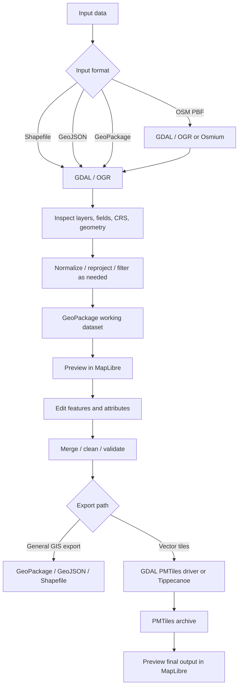
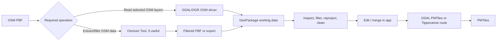

# GIS Desktop App — Stacks, Pipelines & Workflows

> **Project goal:** Build a personal Windows desktop GIS tool that imports geographic data, displays it on a MapLibre map, supports editing and combining datasets, and exports vector maps as PMTiles.
>
> **Status:** Working design, not a claim that every tool choice has been benchmarked. The main open decision is whether GDAL can replace Tippecanoe for the project's PMTiles-generation needs.

## Current repository structure (as built)

The checked workspace currently contains an Electron pipeline console and two Node.js processing projects. This is narrower than the GIS application described in the goals below.

```text
MapFusionDesktop/
├── index.html, styles.css, renderer.js   # Pipeline console UI
├── main.js                               # Electron window and IPC handler
├── preload.js                            # Restricted renderer API
├── package.json                          # Desktop scripts and Electron dependencies
├── scripts/runMergedProject.js           # Runs Data, then MapPipeline
├── Data/
│   ├── index.js, package.json, README.md  # OSM-to-GeoPackage entry point
│   ├── src/config/                       # CLI options and defaults
│   ├── src/pipeline/                     # OSM extraction and GeoPackage conversion
│   ├── src/{gdal,osmium,utils,validation}/
│   └── world/                            # Existing GeoJSON and GeoPackage artifacts
├── MapPipeline/
│   ├── generate.js, validate-output.js   # GeoJSON generation and output validation
│   ├── geojson-files/                    # Country and world inputs
│   └── output/                           # Metadata, labels, and PMTiles artifacts
└── gis-desktop-app-workflows.md          # Design notes and workflow documentation
```

### Implemented entry points

| Command                                 | Current behavior                                                                                                                                                                    |
| --------------------------------------- | ----------------------------------------------------------------------------------------------------------------------------------------------------------------------------------- |
| `npm start`                             | Opens the Electron console.                                                                                                                                                         |
| `npm run start:merged`                  | Runs `scripts/runMergedProject.js`, which runs the Data project and then MapPipeline. The launcher installs a subproject's npm dependencies if its `node_modules` folder is absent. |
| `npm run check`                         | Syntax-checks the root Electron files and merged launcher.                                                                                                                          |
| `npm run build` / `npm run dist`        | Runs electron-builder for a Windows unpacked directory.                                                                                                                             |
| `npm run build:installer`               | Runs electron-builder for a Windows package.                                                                                                                                        |
| `npm run start --prefix Data`           | Processes an `.osm.pbf` input into administrative boundaries in GeoPackage format; requires `osmium` and `ogr2ogr`.                                                                 |
| `npm run generate --prefix MapPipeline` | Processes GeoJSON inputs into metadata, labels, and PMTiles; requires `tippecanoe` and `pmtiles` except in metadata-only mode.                                                      |
| `npm run validate --prefix MapPipeline` | Validates the existing metadata, labels, and PMTiles artifacts.                                                                                                                     |

The Electron renderer displays a status/output console and calls `run-merged-project` through the preload API. It does not currently display a map. There is no MapLibre initialization, PMTiles protocol registration, or MapLibre dependency in the application packages; MapLibre in this document is a planned target, not current runtime behavior.

### Current inspection result

The root and Data syntax checks passed, the MapPipeline generator syntax check passed, and the existing MapPipeline output validator passed for two country records and their map artifacts. The Electron start command remained running without an immediate terminal error; the pipeline button was not run. A full pipeline run was not attempted because `Data/world.osm.pbf`, `osmium`, `ogr2ogr`, `tippecanoe`, and `pmtiles` were not available in the inspected environment. No dependencies were installed and no application behavior or project structure was changed as part of this inspection.

## 1. Goals and scope

The application should let me:

- Import **Shapefile**, **GeoJSON**, **GeoPackage**, and **OSM PBF** data.
- Inspect layers, fields, geometry types, feature counts, and coordinate reference systems (CRS).
- Display source data and generated PMTiles in **MapLibre GL JS**.
- Manage map layers: show/hide, reorder, and style them.
- Edit geographic features and their attributes, and create/delete features.
- Combine data from several sources and export the working dataset.
- Generate **PMTiles** for efficient vector-map display in MapLibre.
- Run locally on my own Windows machine. Packaging for other users is not currently a requirement.

## 2. Proposed stack

| Area                                  | Proposed technology                           | Role / status                                                                                                                 |
| ------------------------------------- | --------------------------------------------- | ----------------------------------------------------------------------------------------------------------------------------- |
| Desktop shell                         | **Electron**                                  | Package the React app as a Windows desktop application; provides the main process for invoking local tools.                   |
| UI                                    | **React**                                     | Application interface, layer panel, import/export workflows, settings, and editing controls.                                  |
| Map rendering                         | **MapLibre GL JS**                            | Render the working map and PMTiles output.                                                                                    |
| PMTiles integration                   | **PMTiles protocol/library for MapLibre**     | Let MapLibre read a PMTiles archive.                                                                                          |
| Geospatial conversion and data access | **GDAL / OGR**                                | Read, inspect, convert, reproject, and combine supported vector datasets.                                                     |
| Python interface                      | **GDAL Python bindings (`osgeo`)**            | Call GDAL/OGR operations from Python scripts when scripting is useful.                                                        |
| Python/GDAL environment               | **Miniforge + Conda-Forge**                   | Install GDAL and its native dependencies in a manageable environment on Windows.                                              |
| OSM-specific processing               | **Osmium Tool** (optional)                    | Useful for OSM PBF filtering, extraction, and OSM-focused processing where GDAL alone is insufficient.                        |
| Vector tile generation                | **GDAL PMTiles driver** and/or **Tippecanoe** | Test both paths; final choice depends on output quality, controls, and performance.                                           |
| Optional intermediate archive         | **MBTiles**                                   | Useful if using a Tippecanoe → MBTiles → PMTiles conversion workflow.                                                         |
| Editable working format               | **GeoPackage (`.gpkg`)**                      | Recommended main working/intermediate format for multi-layer vector data.                                                     |
| Existing application backend          | **Node.js / Express, if needed**              | Keep only for existing online features/API. Local GIS import, editing, and export do not inherently require a remote backend. |

### Architecture rule

- **Electron main process:** launches local command-line tools and manages file-system operations.
- **React renderer:** handles UI and map interaction; it should not call `child_process` or receive unrestricted Node.js access directly.
- **Preload + IPC:** expose a small, validated set of operations to the renderer (e.g. inspect file, convert layer, run export, read job progress).
- **Local processing:** run GDAL/OGR and other CLI tools as subprocesses, or use controlled Python scripts.
- **MapLibre:** renders the map; it is not the geospatial processing engine and is not a full GIS editor by itself.

## 3. Main data pipeline



## 4. Workflows by task

### Workflow A — Import and inspect a dataset

1. The user chooses a file.
2. Electron checks the extension and delegates inspection to GDAL/OGR (or an OSM-focused tool where appropriate).
3. The app displays available layers, geometry types, feature counts, CRS, and fields.
4. The user chooses which layer(s) to load and whether any conversion or reprojection is needed.
5. The app previews the selected data on MapLibre.

**Important:** a Shapefile is normally a group of related files, not only the `.shp` file. Keep its sidecar files together. For recurring edits or multiple layers, import it into a GeoPackage working copy.

### Workflow B — Convert formats

Typical conversions include:

- Shapefile → GeoPackage
- GeoJSON → GeoPackage
- GeoPackage → GeoJSON
- GeoPackage → Shapefile
- OSM PBF → selected OSM layers in GeoPackage (or another suitable format)

Use GDAL/OGR for format conversion and CRS transformation where supported. Before running a conversion, let the user choose the input layer, target format, CRS, output path, and overwrite behavior where relevant.

**OSM PBF note:** the layers exposed by the GDAL OSM driver depend on the driver and its configuration. Common layer names include `points`, `lines`, `multilinestrings`, `multipolygons`, and `other_relations`, but the application should inspect the actual input instead of assuming a fixed list. For large PBF files or OSM-specific filtering, evaluate Osmium as well.

### Workflow C — Edit data and combine sources

1. Load the selected source layer(s).
2. Keep an editable working copy in GeoPackage.
3. Display layers in the MapLibre canvas.
4. Implement map editing controls for selecting, drawing, moving, deleting, or changing geometries, plus editing feature attributes.
5. Support merge/append operations and make field mapping explicit when schemas differ.
6. Validate geometry, required fields, and CRS compatibility before saving.
7. Save edits to the working dataset, then export a new copy or generate PMTiles.

**Editing distinction:** MapLibre renders the map but does not itself provide a complete GIS editing system. Feature selection, geometry editing, attribute forms, undo/redo, persistence, and validation need to be implemented or delegated to a suitable GIS editing component.

**Source-of-truth rule:** treat GeoPackage (or another editable source format) as the working data. Treat PMTiles as a derived display/export artifact, not as the primary editable database.

### Workflow D — Generate PMTiles from vector data

```mermaid
flowchart TD
    A[Clean working dataset] --> B[Select layer(s) and fields]
    B --> C[Choose CRS and zoom range]
    C --> D{Generator}
    D -->|GDAL 3.8+ PMTiles driver| E[Write PMTiles directly, if workflow is supported]
    D -->|Tippecanoe| F[Generate vector tiles / MBTiles]
    F --> G[Convert MBTiles to PMTiles]
    E --> H[Validate PMTiles]
    G --> H
    H --> I[Load archive with PMTiles protocol in MapLibre]
    I --> J[Check visual quality, zoom levels, attributes, size]
```

There are two candidate routes:

**Route 1 — GDAL direct to PMTiles**

- Simpler potential path: supported source format → GDAL PMTiles driver → `.pmtiles`.
- The PMTiles vector driver is available from GDAL 3.8 onward.
- Verify that the specific data and options are supported. Direct support does not guarantee output identical to Tippecanoe.

**Route 2 — Tippecanoe**

- Candidate for more specialized vector-tile generation and controls over zoom levels, simplification, and feature density.
- A common workflow is source data → Tippecanoe → MBTiles → PMTiles.
- Since a convenient native Windows setup is uncertain in this project, run Tippecanoe in the existing Ubuntu environment or through WSL if that fits the workflow. WSL is a development/workstation choice, not a requirement to settle immediately.

**Do not choose solely by whether the command succeeds.** Compare archive size, generation time, geometry/generalization quality at low and high zooms, retained attributes, supported CRS, and the map's appearance in MapLibre.

### Workflow E — Preview the generated PMTiles

1. Keep the `.pmtiles` file at a known local path.
2. Register the PMTiles protocol with MapLibre.
3. Add a vector source/layer using the archive's PMTiles URL/path and its layer metadata.
4. Confirm that source-layer names, style properties, zoom limits, and coordinate expectations match the generated archive.
5. Test multiple zoom levels and compare the result with the working source layer.

A successful archive generation is not sufficient by itself: validate that its metadata and vector layers are readable by the client and that the styling points to the correct source-layer names.

## 5. OSM PBF pipeline



Recommended approach:

- Inspect the PBF first and decide which OSM content is actually needed (for example, roads, buildings, boundaries, or points of interest).
- Avoid converting a large country-scale PBF into one giant GeoJSON by default; it can consume substantial disk space and memory. GeoPackage or filtered intermediate data may be more practical.
- Do not assume every OSM relation or tag will map perfectly into every output format. Check the resulting fields and geometries.
- Keep raw source data unchanged and perform transformations on a working copy.

## 6. Windows setup and how the app launches tools

### Development environment

1. Install Miniforge.
2. Create a Conda-Forge environment with Python and GDAL.
3. Verify `gdalinfo`, `ogr2ogr`, and `from osgeo import gdal, ogr`.
4. Install/test Osmium or Tippecanoe only if a workflow requires it; they are separate from GDAL.
5. Connect the Electron main process to the installed tool paths.

### Safe process boundary

The renderer should send structured requests through IPC, for example:

- `inspectDataset(path)`
- `convertDataset(options)`
- `mergeLayers(options)`
- `generatePmtiles(options)`
- `cancelJob(jobId)`

The main process should validate paths and options, invoke a known executable using argument arrays (not a concatenated shell command), capture stdout/stderr, report progress/errors, and handle cancellation. Do not expose arbitrary command execution to the renderer.

Because this is for personal use, it is reasonable initially to rely on tools installed on the same PC. The trade-off is that the application depends on their installation paths and environment. If the app later needs to be portable, revisit packaging the runtimes and native dependencies.

## 7. What is decided vs. still open

### Decisions / working assumptions

- The application is for personal use on Windows; distribution to other users is not a current requirement.
- Electron + React is the proposed desktop structure.
- MapLibre GL JS is the map renderer.
- GDAL/OGR is the primary general-purpose conversion and geospatial data-access toolkit.
- GeoPackage is the preferred editable/intermediate working format.
- PMTiles is a derived output for efficient MapLibre display.
- Local tools can be launched by Electron's main process through validated IPC.

### Still to test or decide

- Whether GDAL's PMTiles writer provides sufficient control and quality for the real datasets.
- Whether Tippecanoe is necessary for certain outputs, and whether to use Ubuntu or WSL for it on Windows.
- Which OSM PBF layers and tags are needed, and whether Osmium should be part of the regular workflow.
- How much editing to implement: attribute-only, geometry editing, or full interactive GIS-style editing.
- Which CRS and zoom ranges should be defaults for generated PMTiles.
- Whether the existing Node/Express backend is needed for any features of this desktop application. File processing alone does not require a remote backend.

## 8. Validation checklist for the first prototype

- [ ] Open a small Shapefile and verify all related files/layers are handled correctly.
- [ ] Import GeoJSON and GeoPackage and inspect their CRS, fields, and geometries.
- [ ] Convert a selected layer to GeoPackage and back to GeoJSON.
- [ ] Open a sample OSM PBF and inspect available layers; export only a selected subset.
- [ ] Display imported layers in MapLibre.
- [ ] Edit at least one feature and attribute, save, close, and reopen the working dataset.
- [ ] Merge two datasets with different schemas and check field mapping and CRS.
- [ ] Generate one PMTiles archive with GDAL and, separately, with Tippecanoe if available.
- [ ] Compare generation time, file size, zoom behavior, geometry quality, and retained properties.
- [ ] Open both results in MapLibre and verify the styling and source-layer names.
- [ ] Test a large dataset only after the small-data workflow is reliable.

## 9. Official references

- [GDAL documentation](https://gdal.org/en/stable/)
- [GDAL Python bindings](https://gdal.org/en/stable/api/python/python_bindings.html)
- [GDAL PMTiles vector driver](https://gdal.org/en/stable/drivers/vector/pmtiles.html)
- [Conda-Forge](https://conda-forge.org/)
- [Miniforge](https://conda-forge.org/download/)
- [Tippecanoe](https://github.com/felt/tippecanoe)
- [PMTiles documentation](https://docs.protomaps.com/pmtiles/)
- [MapLibre GL JS documentation](https://maplibre.org/maplibre-gl-js/docs/)
- [Osmium Tool documentation](https://osmcode.org/osmium-tool/)
